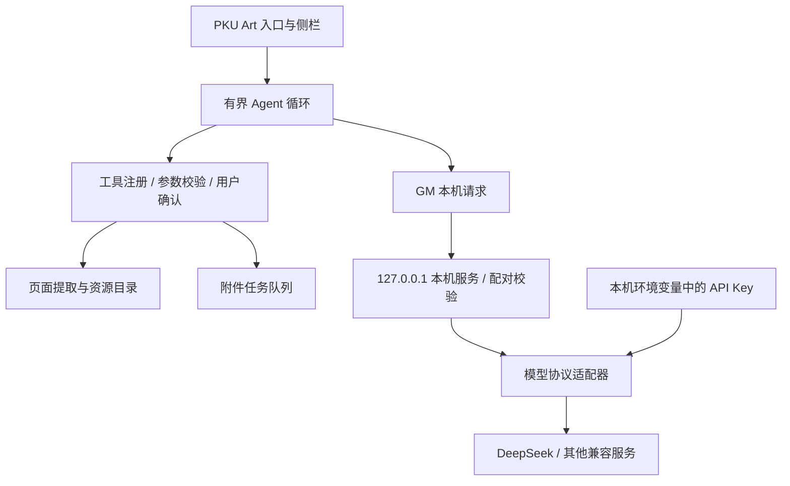

# AI 架构与扩展约定

## 数据流与模块



| 模块 | 职责 |
| --- | --- |
| `src/agent/index.js` | 页面挂载、配置存储、任务生命周期 |
| `panel.js` / `panel-style.js` | Shadow DOM 界面、共享预览、操作确认，继承原主题变量与事件 |
| `runner.js` | 用户请求 → 模型 → 工具 → 实际结果 → 模型；上限、取消、错误反馈 |
| `registry.js` | 工具 schema、参数校验、授权检查，与模型提供方无关 |
| `page.js` | 同源 iframe、正文过滤、带类型的资源目录；内部 URL 不直接作为工具参数 |
| `tools.js` | 第一批教学网工具，作用范围明确，不接受任意 URL 或代码 |
| `queue.js` / `downloads.js` | 顺序任务、状态、取消；浏览器下载为注入的执行器 |
| `transport.js` | 只连接 `127.0.0.1`，配对码认证与取消 |
| `bridge/server.js` | 请求大小、来源、Host、并发、超时、模型白名单；不执行系统命令 |
| `bridge/providers.js` | 服务端模型调用；环境变量取密钥，不把供应商错误正文回传网页 |

浏览器侧执行教学网操作，借用现有会话。本机模型代理不接收教学网 Cookie，也不登录教学网。LLM 只提出工具调用；工具执行前必须经过代码校验。工具结果和页面文字都是资料，不能授予权限。

## 三种不同的扩展

1. **增加兼容模型**：只编辑 `agent.config.local.json`，无需修改网页脚本。
2. **增加模型协议**：在 `bridge/` 实现一个适配器，提供与 `completeChat` 相同的一轮调用契约，并在配置验证/分发中注册。当前只实现 Chat Completions。
3. **增加工具**：在浏览器侧注册 schema、严格参数校验、权限和执行器。新增工具需要重新构建脚本，不能通过远程配置注入 JavaScript。

## 工具契约

```js
registry.register({
  name: 'pku_example',
  description: '清楚说明范围与限制',
  parameters: { type: 'object', properties: {}, additionalProperties: false },
  permission: 'read', // 只读本次已批准范围；额外读取或副作用必须为 confirm
  validate(args) { /* 拒绝额外字段、超长数组、未知资源 ID */ },
  execute(args, { signal, onEvent }) { /* 返回真实结构化结果；响应取消 */ }
});
```

`permission: 'confirm'` 还必须提供 `preview(args)`，展示具体目标与动作。注册表先校验参数，再请求确认，最后检查取消状态并执行。不要以“模型已经说用户同意”为授权依据。资源工具使用本地目录生成的 ID，防止模型伪造下载地址。

副作用工具不能直接传入 `eval`、shell、任意 DOM 点击或任意 URL。这些不是通用性的必要条件。通用性来自可组合、可审计的工具契约。

## 对语音参考版本的借鉴

参考：[qingshungLI/PKU-Art](https://github.com/qingshungLI/PKU-Art) 的 `src/videoText.js` 与 `video-text/`。

- 功能独立成模块，在 `main.js` 挂载，而非把所有逻辑加入原有 `utils.js`。
- Shadow DOM 隔离 UI，同时继承 `--c-*` 主题变量。
- `GM_xmlhttpRequest` 连接回环服务，计算任务留在本机服务。
- 明确区分“排队、执行、完成”，通过任务 ID 查询实际状态。
- 课堂实录使用 `videoList.action` 与 `playVideo.action`；播放器鉴权在实际播放环境内处理。

本版本没有合并、运行或复制其转写服务。以后可以写一个转写适配工具：准备受限录播任务 → 用户确认 → 调用外部转写服务 → 查询任务状态 → 将用户批准的文字结果交给总结模型。视频鉴权和媒体密钥只在执行器之间流转，不能送入聊天上下文。现有语音服务的请求头和任务接口不等同于本项目的配对协议，需要明确适配、验证 origin/source、超时与取消，不能直接让模型访问任意本机端口。

## Codex 路线

当前实现直接调用兼容 API，没有启动 Codex。后续可在本机服务增加 Codex App Server 适配器，用 MCP 提供同一批工具，并将浏览器侧权限检查保留为最终执行关卡。不能因为 Codex 能运行 shell，就给课程助手开放整台电脑。App Server 的会话和工具事件与 Chat Completions 不同，需要独立连接器与集成测试。

## 后续优先级

1. 在真实已登录教学网验收页面与 iframe 结构、GM 权限、主题和附件下载。
2. 将课程发现、录播分页、播放器执行器做成独立适配器，随后实现跨页面批量录播下载。特别验证用户手势、保存目录、登录过期与 HLS 支持范围。
3. 为长任务加入本机持久化、明确的恢复策略、去重和任务取消；刷新恢复不能仅靠保存 UI 状态。
4. 文档解析、外部转写结果导入、Codex/MCP 适配，分别作为可选模块。

## 验证

```sh
npm ci
npm run test:agent
npm run build:local
```

自动测试使用本机模拟模型，不使用真实密钥或付费 API。真实模型工具调用及学校登录环境仍需用户配置后验收。CI 独立运行 Agent 测试和本地构建，不调用上游的 CDN 发布脚本。
